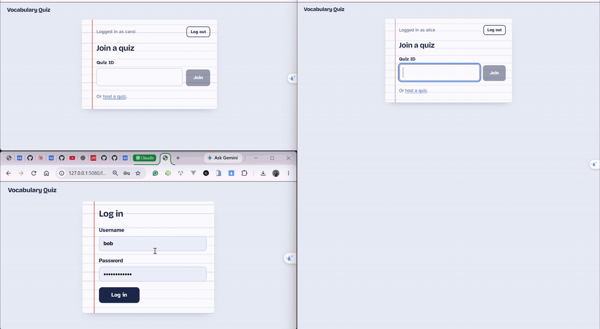

# Live vocabulary quiz

A Kahoot-style live quiz for vocabulary practice: an organizer opens a session, players join with
the quiz ID, everyone answers the same timed question, and results and the leaderboard appear
when each question closes. Real-time .NET 10 server (Minimal API + SignalR + EF Core SQLite) and
a small React client.

- Design: [docs/DESIGN.md](docs/DESIGN.md)
- Spec and acceptance criteria: [docs/TASK.md](docs/TASK.md); plan: [docs/PLAN.md](docs/PLAN.md)
- How the AI was used: [docs/AI-COLLABORATION.md](docs/AI-COLLABORATION.md)
- How the agent works in this repo: `CLAUDE.md` and `.claude/`

## Demo

Three players in three browser windows at once: alice (left, the organizer, who also plays),
bob and carol. alice opens a session, the others join with the quiz ID, alice starts, everyone
answers, and each question ends with the correct answer, points, rank and the top 10.



Full recording (60 s, mp4):
[vocab-quiz-end-to-end-demo.mp4](https://github.com/pdxuan/quiz-challange/releases/download/demo-v1/vocab-quiz-end-to-end-demo.mp4)
(release [demo-v1](https://github.com/pdxuan/quiz-challange/releases/tag/demo-v1)). It was
recorded on a temporary database whose quiz sets were cut to 5 questions.

## How to run

### Without installing .NET or Node

- **Prebuilt build** (Windows x64, Linux x64, macOS Apple silicon): download it from the
  [demo-v1 release](https://github.com/pdxuan/quiz-challange/releases/tag/demo-v1), unpack it
  and run `start.cmd` (Windows) or `./start.sh` (Linux, macOS), then open http://localhost:5080.
  The macOS build is unsigned: if macOS blocks it, run
  `xattr -dr com.apple.quarantine vocab-quiz-osx-arm64` once.
- **Docker**: from a clone of this repo,

  ```
  docker compose up --build
  ```

  then open http://localhost:5080. The SQLite file and the login-cookie keys are kept in the
  `quiz-data` volume; `docker compose down -v` starts from scratch.

Both run in demo mode (Development: the dev users below and 2 quiz sets are seeded, Swagger UI
at http://localhost:5080/swagger).

### From source

Prerequisites: .NET SDK 10, Node 24 (npm 11).

#### Server

```
dotnet run --project src/Quiz.Server --launch-profile http
```

Listens on http://localhost:5080 (Development). On first start it creates
`src/Quiz.Server/App_Data/quiz.db`, applies the migrations and, because the database is empty,
seeds 2 quiz sets ("Everyday words", "Travel words") and 3 dev users:

| Username | Password (dev mock data only) |
|----------|-------------------------------|
| alice | alice-dev-pass |
| bob | bob-dev-pass |
| carol | carol-dev-pass |

Swagger UI: http://localhost:5080/swagger. Health: http://localhost:5080/health.
To start from scratch, stop the server and delete `src/Quiz.Server/App_Data/quiz.db`.

#### Web client

Either run the Vite dev server (proxies `/api` and `/hubs` to the server on port 5080):

```
npm --prefix web install
npm --prefix web run dev
```

or build it into `src/Quiz.Server/wwwroot` so one `dotnet run` serves everything on port 5080:

```
npm --prefix web install
npm --prefix web run build
dotnet run --project src/Quiz.Server --launch-profile http
```

Try it: log in as `alice` and open a session from a quiz set. alice lands in her own lobby (she
plays too) with the quiz ID, a Start button and an "Organizer board" link (full board, new tab).
Log in as `bob` and `carol`, join with the quiz ID; Start opens once two players are online.

The login cookie belongs to the host name, so one browser can hold three users at once:
alice on http://localhost:5080, bob on http://127.0.0.1:5080, carol on http://[::1]:5080.

### Tests

The test command (also in `.claude/test-cmd`):

```
dotnet test Quiz.slnx && npm --prefix web test -- --run
```

Server tests run the real server in memory, each on its own SQLite file with a fake clock,
including the end-to-end tests in `tests/Quiz.Server.Tests/EndToEnd` (20 players in one quiz;
3 sessions of 20 players at once). Their run times are printed with
`dotnet test Quiz.slnx --filter FullyQualifiedName~EndToEnd --logger "console;verbosity=detailed"`.

### Final evidence run

What was run for the Status table in [docs/TASK.md](docs/TASK.md#status), on 2026-10-22:

```
dotnet test Quiz.slnx && npm --prefix web test -- --run   # 216 + 37 passed, 0 skipped
npm --prefix web run build
dotnet run --project src/Quiz.Server --launch-profile http
```

Then real HTTP and SignalR calls against http://localhost:5080 (a Node script with
`@microsoft/signalr`): login (wrong password 401, alice and bob 200), quiz sets (anonymous 401,
logged in 200), create a session (201), alice and bob `JoinQuiz` (bob with the lowercase ID),
start with one player (409 `NoPlayers`) and with two (200), `QuestionStarted` without the
correct option, both answer (`AnswerAccepted`), a late answer (`QuestionClosed`), each player's
own `QuestionClosed`, `WatchQuiz` by bob (`NotOrganizer`), the leaderboard (200) and an unknown
quiz (404). `/openapi/v1.json` lists every REST endpoint of the Contract with its status codes
(`/health` is a health check, not in the document). After a restart on the same database the
leaderboard of that quiz still returned alice's points.

### Metrics

```
dotnet tool install --global dotnet-counters
dotnet-counters monitor -n Quiz.Server --counters Quiz.Server
```

Shows live sessions, hub connections, answers accepted and rejected (by error code), actor
message latency (including the database) and question close-to-push latency.

## Video outline (5-10 min)

1. **The problem (1 min).** A live quiz where many players answer the same timed question;
   the hard part is one session's state changing from answers, the organizer and the clock at once.
2. **Demo (2-3 min).** Start the server; log in as alice (organizer), create a session, bob and
   carol join by quiz ID; start; answer, one late; the reveal shows correct option, points,
   total, rank and top 10; disconnect and rejoin a player; the final board. Show
   `dotnet-counters` alongside.
3. **Architecture (2 min).** DESIGN.md diagrams: one process, SQLite as the only state, one
   actor per session (load-apply-save per message, push after commit); the three options
   considered and why the actor won; the join -> answer -> leaderboard sequence.
4. **Correctness (1-2 min).** Pure `Session` state machine with explicit `now`; server-stamped
   receive time; results only at close; restart resume. The end-to-end tests: 20 players with
   late answers and a rejoin, totals and ranks recomputed from the `Answers` rows; 3 sessions at
   once with no cross-session events; run times.
5. **AI collaboration (1-2 min).** Intake -> plan -> slices with tests first, reviewer agent,
   human gate for TRUNK, parallel worktrees for LEAF slices, mutations; two examples of what the
   AI got wrong and how it was caught (AI-COLLABORATION.md).
6. **At scale (30 s).** What changes first: PostgreSQL, broadcast top 10 plus a small personal
   result, a SignalR backplane, routing each quiz to one node.
