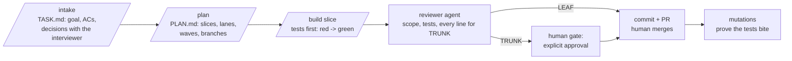

# AI collaboration

How this project was built with an AI coding agent, what it got wrong, and how the work was
checked. Per-slice notes are linked below; this page is the summary.

## Tools

- **Claude Code** (Claude Opus 5.5) in the terminal, as the only coding agent.
- A project kit in `.claude/`: skills for each step (`/intake`, `/plan`, `/build`,
  `/post-review`), a **reviewer agent**, coding and testing rules (`.claude/rules/`), and hooks:
  a trunk guard (workers cannot edit TRUNK files), a test gate (no commit unless the test
  command is green, never on the base branch) and a session-context hook that prints the
  current slice.
- Git worktrees for LEAF slices that run in parallel (S5 web and S6 seed + E2E).
- `dotnet test`, Vitest, `dotnet ef`, `dotnet-counters`; GitHub PRs for every slice.

## Prompt style

- **The spec lives in the repo, not in chat.** `docs/TASK.md` holds the goal, architecture,
  contract, assumptions and numbered acceptance criteria; `docs/PLAN.md` holds the slices. A
  slice prompt is short: "build S4" plus the slice block, its Files list and the ACs it covers.
- **Questions before code.** Anything that changes behaviour and is not covered by an
  assumption is asked, not guessed (e.g. results only at close, seeded logins, the schema keys,
  what the leaderboard shows during an open question). Answers are recorded as decisions.
- **Tests first, shown red.** Every slice starts with tests through the public boundary
  (`WebApplicationFactory`, real SignalR clients, a real SQLite file, `FakeTimeProvider`), run
  red for the expected reason, then the smallest code that passes.
- **Expected values from inputs.** Tests compute expected points and ranks from what they sent,
  never from the database they are checking.
- **Concrete corrections.** When the AI is wrong, the correction names the file, the failing
  output and the rule, and the fix comes with a test.

## Workflow



- **Lanes.** TRUNK slices (shared model, schema, Program.cs, test host) ran one at a time in the
  main session and needed the interviewer's approval after review. LEAF slices ran in parallel
  in worktrees and were reviewed in the PR. ONE-WAY items (new packages, schema) stopped for an
  explicit OK first.
- **Reviewer agent.** Every slice got a review pass before its commit; findings are Must /
  Should / Could, and the interviewer picked which Shoulds to fix.
- **Mutations.** After green, small deliberate bugs were applied to show that the tests fail
  (tables in the slice notes), then the code was restored.

## Marking AI-assisted code

All code in this repo was written with Claude Code and then reviewed. The significant generated
files carry a first-line marker naming the tool, the slice and where the verification evidence
is, for example:

```csharp
// AI-assisted: Claude Code (Claude Opus 5.5), slice S3; reviewed by a reviewer agent and a human; verified by Runtime/SessionActorTests, mutations (docs/ai-collab/s3.md).
```

Server files are marked in S6; the web views and hub client are marked in the S5 fix commit.

## Slices

| Slice | What | Notes |
|-------|------|-------|
| S0 | Walking skeleton: solution, feature stubs, OpenAPI/Swagger, health, SPA fallback, web scaffold | [ai-collab/s0.md](ai-collab/s0.md) |
| S1 | Domain: `Session` state machine, scoring, ranking, quiz IDs | [ai-collab/s1.md](ai-collab/s1.md) |
| S2 | Data and auth: EF Core SQLite, migrations, cookie login | [ai-collab/s2.md](ai-collab/s2.md) |
| S3 | Session actor, registry, recovery, sessions API | [ai-collab/s3.md](ai-collab/s3.md) |
| S4 | Quiz hub and real-time events | [ai-collab/s4.md](ai-collab/s4.md) |
| S5 | Web client (built in parallel with S6) | [ai-collab/s5.md](ai-collab/s5.md) |
| S6 | Quiz sets, seed, end-to-end tests, docs | [ai-collab/s6.md](ai-collab/s6.md) |

## What the AI got wrong (across slices)

- **Tests that locked in a bug.** S1: a restart test only covered a question that was not
  overdue, so a tick that closed *and* finished the quiz in one step passed; the reviewer
  caught it. S4: a draft 20-player test computed expected ranks from the database it was
  checking.
- **Tests that were wrong, not the server.** S4: a "late" joiner joined at the very instant the
  question started (the fake clock had not moved); answers fired without awaiting while the
  clock moved.
- **Startup and resilience gaps found in review.** S3: one unreadable session stopped the whole
  server from starting; idle Lobby actors ticked forever; a broken session logged ten errors a
  second. S4: `WatchQuiz` joined its groups after the snapshot (lost events); one outbox for all
  sessions let a slow client delay everyone.
- **Plan items silently skipped.** S2: the UTC converter and the explicit busy timeout were in
  the plan but not in the code until review.
- **Tooling details.** Template packages not on the approved list (S0), a tool manifest in the
  wrong folder (S0), a `RequestDelegate` binding that dropped a result (S2), a stale DLL after
  restoring a mutation with `mv` (S2), CS0121/CS1061/CS9176 compile errors.
- **Environment overlap.** S6: seeding "in Development into an empty DB" also fired in the test
  host (Development, fresh DB) and broke 56 tests on the unique username; fixed with a
  `Seed:Enabled` flag that the test host turns off.
- **Log noise mistaken for errors.** S6: SignalR logs every rule rejection (`HubException`) at
  Error level; the E2E check now expects exactly one per late answer.

## End-to-end run times (AC35, AC36)

Measured with a `Stopwatch` in the tests and printed through `ITestOutputHelper`; in-memory
test server, SignalR long polling, a real SQLite file, fake clock (no real waiting for
deadlines), Windows 11 dev laptop, Debug build.

| Test | Load | Accepted / late rejected | Run alone | In the full suite |
|------|------|--------------------------|-----------|-------------------|
| AC35 full quiz | 1 organizer + 20 players, 5 questions, one disconnect + rejoin | 78 / 17 | 6.3 s | 7.6 s |
| AC36 concurrent sessions | 3 sessions x (1 organizer + 20 players), 5 questions | 237 / 53 | 20.1 s (setup 6.4 s) | 26.6 s (setup 9.6 s) |

Both runs: every player's final total and rank equal the values recomputed from the `Answers`
rows, no event reached another session, and no unexpected error was logged. The time is
dominated by long-polling round trips of 63 test clients, not by the server's work per answer.

## Verification notes per slice

| Slice | Red first | Green | Mutations |
|-------|-----------|-------|-----------|
| S0 | 9/12 server tests, web test missing `./App` | 12 server, 6 web | production 404 tests guard the SPA fallback |
| S1 | no `Quiz.Server.Domain` (compile) | 95 | 3 scoring mutants, all caught |
| S2 | no `QuizDbContext` (compile) | 126 | removed DB health check -> 503 test fails |
| S3 | no `Runtime` (compile) | 162 | 3 mutants (leaderboard, recovery, tick timer), all caught |
| S4 | no `SignalRSessionEvents` (compile) | 186 | 7 mutants, all caught |
| S5 | 23 of 29 web tests against the S0 placeholders | 29 web | 3 mutants (countdown, Start rule, options lock), all caught |
| S6 | 19 failing with stubs (validator, endpoint, seeder, E2E log check) | 209 server, 6 web (with the test host's seed flag off) | 3 mutants (validator x2, seeder), all caught |
