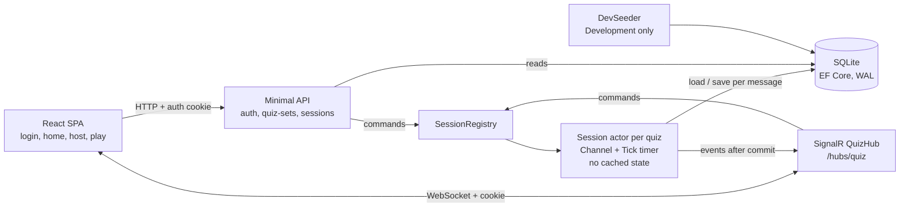
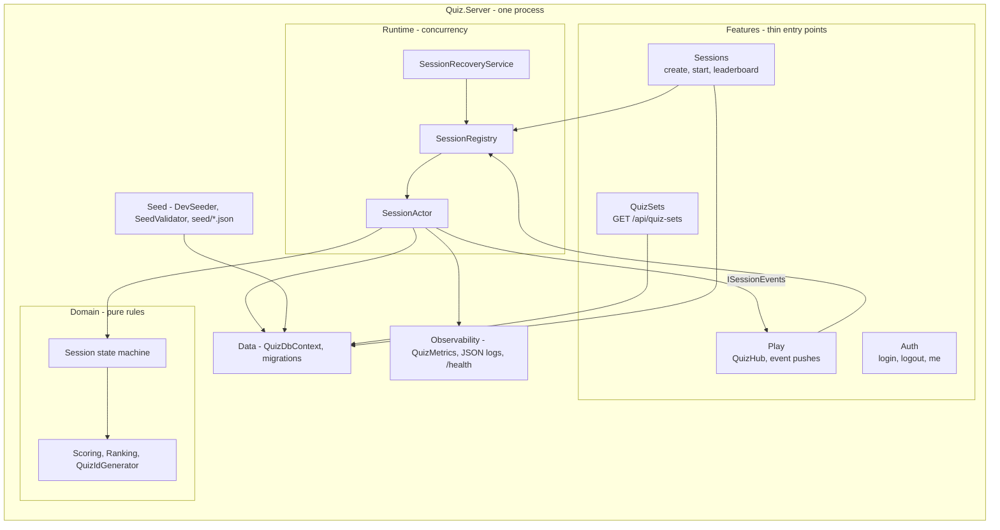
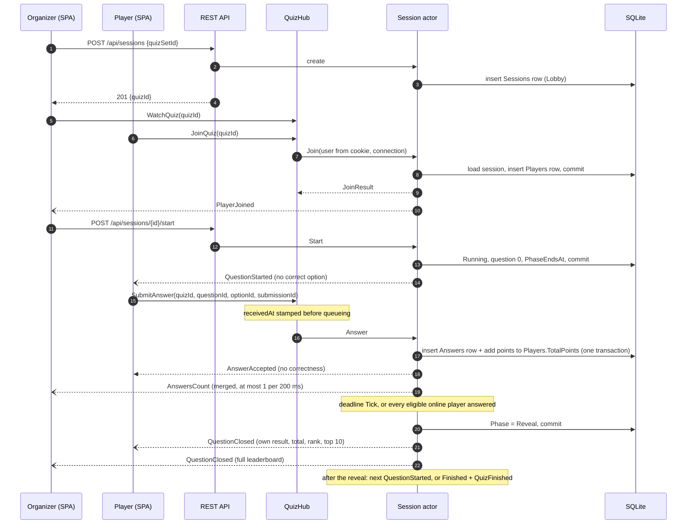

# System design: live vocabulary quiz

A Kahoot-style quiz for an English learning app. A logged-in organizer opens a session from a
quiz set and shares its 6-character quiz ID; logged-in players join with that ID and answer the
same timed question at the same time. When a question closes, each player sees the correct
option, their points, total and rank, and the top 10; the organizer sees the full board.

The full spec (requirements, contract, acceptance criteria) is in [TASK.md](TASK.md); this
document explains the design and why it was chosen.

## 1. Architecture

One .NET 10 process serves the REST API, the SignalR hub and the built React app. SQLite is the
only store of state. Every quiz session has one **actor**: a queue (`Channel<T>`) with a single
reader that loads the session from SQLite, applies one change to a pure `Session` state machine,
saves in one transaction, and only then pushes events.

### Why an actor per session

One session's state changes from three sources at once: players' answers (many hub threads),
the organizer's Start (HTTP) and the clock (deadline, reveal). Rules like "first answer counts"
and "close when every eligible online player has answered" are only correct if no two changes
interleave. The options considered (see TASK.md Architecture):

| Approach | Verdict |
|----------|---------|
| A. Actor per session over SQLite (queue, one load-apply-save transaction per message) | **Chosen.** Ordering holds by construction; rules stay in a pure class; sessions are independent |
| B. DB transactions only (conditional updates, polling for deadlines) | Races move into SQL and retry code; polling adds delay; SQLite's single writer lock couples sessions |
| C. A lock per session around load-apply-save | Least code, but every caller (incl. the timer) must remember the lock; a push under the lock stalls the session |

## 2. Components

| Component | Responsibility |
|-----------|----------------|
| `Features/Auth` | Cookie login against seeded users (`PasswordHasher<T>`), logout, `me`. Deny by default: every endpoint needs a user unless marked anonymous; 401 instead of a redirect |
| `Features/QuizSets` | `GET /api/quiz-sets`: id, title, question count, time limit. Never questions, options or the correct option |
| `Features/Sessions` | Create a Lobby session (caller = organizer), start it (organizer only), read the leaderboard straight from SQLite |
| `Features/Play` | `QuizHub` (`JoinQuiz`, `WatchQuiz`, `SubmitAnswer`, disconnects) and `SignalRSessionEvents`, which turns committed domain events into personalised pushes |
| `Runtime` | `SessionRegistry` (quiz ID -> actor), `SessionActor` (channel, 100 ms `Tick` on the injected `TimeProvider`), `SessionRecoveryService` (resumes `Running` sessions after a restart) |
| `Domain` | `Session` state machine (Lobby -> Running (Question / Reveal) -> Finished), join/rejoin, eligibility, answer rules, early close, all-offline finish; `Scoring` (500 + up to 500 speed bonus); competition `Ranking` |
| `Data` | EF Core Fluent mapping of the domain classes, migrations at startup, WAL mode, 5 s busy timeout, UTC times |
| `Seed` | In Development, into an empty database only: 3 users and 2 vocabulary sets from JSON, checked by `SeedValidator` (4 unique options, a valid correct option, one direction per word) |
| `Observability` | `Quiz.Server` meter (live sessions, connections, answers accepted/rejected by code, actor message latency, close-to-push latency), JSON console logs with quizId/userId scopes, `/health` with a DB check |

## 3. Data flow: from join to leaderboard update

Rules that make the flow correct:

- **Results only at close (D1).** Points are computed when an answer arrives but are revealed
  only at close; while a question is open the leaderboard ranks everyone as they stood before it.
- **Server time only.** `receivedAt` is stamped by the hub before the message is queued, so
  waiting in the queue never costs points; the deadline check runs in the actor, in order with
  the answers, so a late answer cannot slip in after the close (`QuestionClosed` error, no row).
- **One answer per player per question** by construction (messages in order) and by the
  `Answers` primary key `(QuizId, UserId, QuestionId)`; a retry with the same `submissionId`
  gets the original result.
- **Push after commit.** Events are handed to SignalR only after the transaction commits and
  are never awaited inside the actor, so a slow client cannot stall a session.
- **Disconnect = offline, not removed.** A player stays on the board; rejoining (same user) is
  the same player, and an eligible rejoiner can still answer the open question.
- **Restart.** All state is in SQLite; the recovery service restarts the actors of running
  sessions, marks everyone offline and gives a full reveal window to rejoin.

## 4. Technologies and why

| Choice | Why | Not chosen |
|--------|-----|------------|
| .NET 10 Minimal API | Small, fast, built-in OpenAPI; the interview's core component is the server | Controllers (more ceremony) |
| ASP.NET Core SignalR | Real-time push with groups, WebSocket with fallbacks, cookie auth on the same origin | Raw WebSockets (reconnect, groups and framing by hand) |
| `Channel<T>` actor per session | Serialises every change to a session without locks in callers; sessions run independently | Orleans/Akka (too much for one node); locks (easy to miss one) |
| EF Core + SQLite (WAL) | Interviewer asked for all state in a database; migrations version the schema; zero setup | In-memory state (lost on restart); PostgreSQL (setup cost for a demo; the first change at scale) |
| Cookie auth + `PasswordHasher<T>` | Built in; one credential works for REST and the hub | JWT (token plumbing into SignalR), ASP.NET Core Identity (more tables and UI) |
| `TimeProvider` / `FakeTimeProvider` | Deadlines and reveals are tested deterministically with no sleeps | `DateTime.Now`, `Task.Delay` |
| `System.Diagnostics.Metrics` + JSON logs | Built in; readable with `dotnet-counters` | OpenTelemetry exporters (talk only, see TASK.md NFR) |
| React 19 + TypeScript + Vite | Simple SPA, fast dev server with a proxy to the API and hub | A server-rendered UI (the hub client lives in the browser anyway) |
| xUnit + `WebApplicationFactory` + real SignalR clients; Vitest + RTL | Tests go through the public boundary down to a real SQLite file | Mocks of our own code |

## 5. Scale and failure (now vs later)

Built for up to 20 players per session (configurable cap) and several sessions on one node,
proven by the end-to-end tests (20 players in one session; 3 sessions x 20 players at once; run
times in [AI-COLLABORATION.md](AI-COLLABORATION.md)). At scale (talk only): broadcast the top 10
once per group plus a small per-player result, batch answer writes per tick, PostgreSQL, a
SignalR backplane or Azure SignalR Service, and route each quiz ID to one node so its actor
stays single. Details: TASK.md "NFR and scale".

## 6. AI collaboration in the design

The design was produced with Claude Code in a fixed workflow (details in
[AI-COLLABORATION.md](AI-COLLABORATION.md)):

- **Intake:** the AI turned the brief into docs/TASK.md and asked the interviewer the questions
  that changed the design (results only at close, login with seeded users, everything in
  SQLite, build order). Each answer is a row in TASK.md Decisions (D1-D5).
- **Architecture options:** the AI wrote out three concurrency approaches (actor, DB
  transactions, lock) with their costs now and later; the interviewer picked the actor.
- **Plan:** the work was cut into slices with lanes: TRUNK slices (shared model, schema,
  Program.cs) run one at a time with explicit approval; LEAF slices (web, seed + E2E) ran in
  parallel worktrees. The `Seed/` folder was kept apart from `Data/` for exactly that reason.
- **Review:** every slice had a reviewer-agent pass. Several design points came from review,
  not from the first draft: one transition per tick (so a restart never skips a reveal), the
  actor stopping after repeated failures, per-quiz ordered push queues, and joining the
  SignalR group before the join commits.
