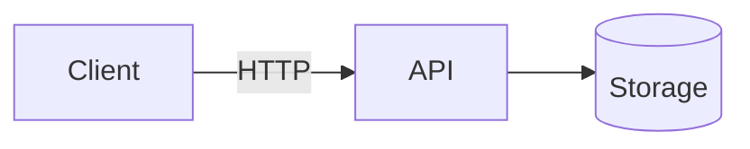

# Task

The spec for this session: requirements, lanes, decisions, evidence. The plan is in `docs/PLAN.md`.

## Goal

One or two sentences: who uses it and the single most important flow.

## Current state

Existing codebase only (filled by `/intake`): what builds, test results at the start
(known-red tests and why), entry points, main flow, files with many dependents.
New project: "n/a".

## Known issues

Existing code only (from the auditor at intake). New project: "n/a".

| # | Severity | file:line | Evidence (observed / suspected) | Impact | Decision |
|---|----------|-----------|---------------------------------|--------|----------|
| K1 | | | | | fix now (R#) / note / out of scope |

## Architecture

Thesis: one line - the simplest design that meets the acceptance criteria, and its main risk.

| # | Approach | Trade-off (cost now / cost to change later) | |
|---|----------|---------------------------------------------|---|
| A |          |                                             | Recommended |
| B |          |                                             | |

Diagram of the recommended approach (A):



- Source of truth: which component decides and validates; the client is never trusted.
- Data model: `Entity(key fields)` and relations, at most 6 entities.
- Key flow: the main request as numbered steps, including one failure path.
- Every box and arrow serves an acceptance criterion; anything else is in Not building.

### Code structure

Chosen per task in `/intake`; the kit does not prescribe one. Style, in one line (e.g.
feature folders on a thin shared core, layered, clean/onion, modular monolith, or what the
existing repo already uses) and why it fits this size of problem.

```text
The real folder tree for this task, e.g. for feature folders:
src/<App>/
  Program.cs           composition root: DI, middleware, one registration per feature
  Features/<Feature>/  endpoint, request/response, handler or service, validator
  ...                  shared core (domain, data, cross-cutting), only what is needed
tests/<App>.Tests/     mirrors the source tree
```

| Concern | Pattern used | Why | Considered, not used (why) |
|---------|--------------|-----|----------------------------|
| Request handling | | | |
| Business rules | | | |
| Data access | | | |
| Validation and errors | | | |
| Authorization | | | |
| Config, time, cross-cutting | | | |

Dependency rule: which folder may reference which (e.g. features never reference each
other; shared core never references features). Existing repo: describe what is there and
follow it; propose a change only as a Decision.

## NFR and scale

Load we design for (agreed, see Assumptions):

| Concern | Now: built and tested | At scale (talk only, not built) | Trigger |
|---------|-----------------------|---------------------------------|---------|
| Load / concurrency | | | |
| Data volume | | | |
| Persistence / recovery | | | |
| Auth / abuse | | | |
| Failure modes (and how we would know) | | | |

A row that does not apply: "n/a - why". Cut rows rather than invent numbers.

## Decisions

Design decisions from intake, at most 5. Decisions made during the build go to docs/PLAN.md.

| # | Decision | Choice and why | Reversible | Status |
|---|----------|----------------|------------|--------|
| D1 | | | two-way / ONE-WAY: rollback = ... | interviewer / default / deferred until ... |

## Requirements

| # | Requirement | Lane | Why this lane |
|---|-------------|------|---------------|
| R1 |            | LEAF / TRUNK / +ONE-WAY | |

## Assumptions

| Question | Answer / assumption | Source |
|----------|---------------------|--------|
|          |                     | interviewer / assumed |

## Contract

Agreed before coding: endpoints (method, path, request, success, errors), or CLI / UI behavior.

| Method | Path | Request | Success | Errors |
|--------|------|---------|---------|--------|
|        |      |         |         |        |

## Acceptance criteria

Each line becomes at least one test.

- [ ] AC1:

## Not building

- X - why.

## Safety

- What must not change:
- Worst case if this is wrong:
- How to roll back:

## Status

| Acceptance criterion | Evidence (test or request) | Result |
|----------------------|----------------------------|--------|
|                      |                            |        |

- Not verified:
- Next, with more time:
- At scale, first change: (from NFR and scale, with its trigger)
