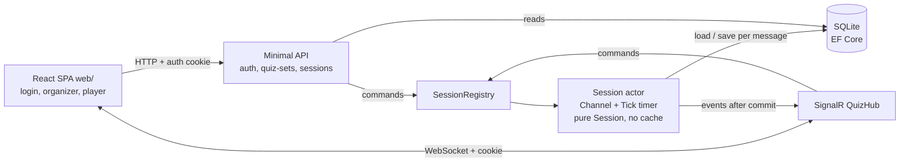
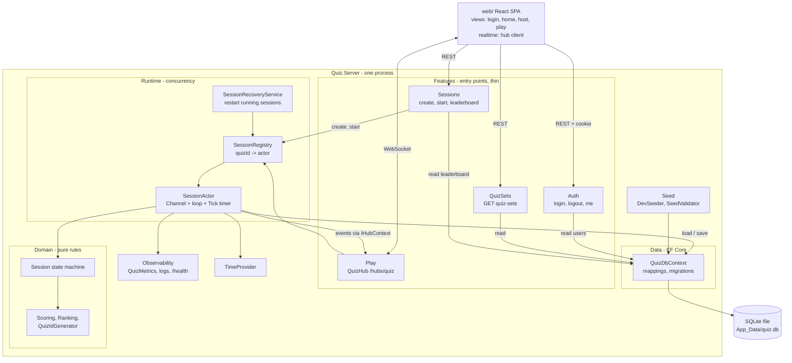
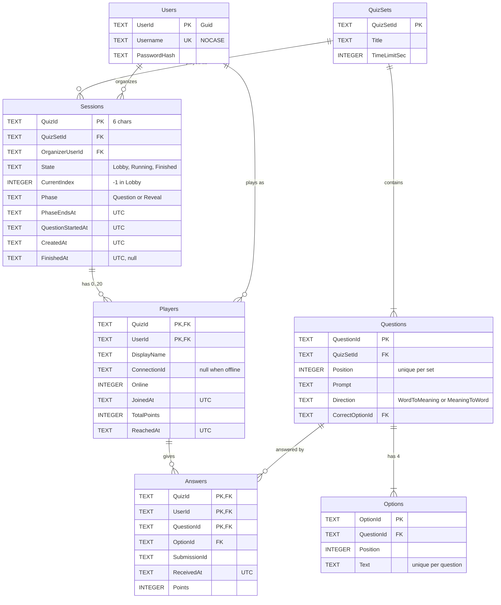

# Task

The spec for this session: requirements, lanes, decisions, evidence. The plan is in `docs/PLAN.md`.

## Goal

A Kahoot-style live vocabulary quiz for an English learning app: a logged-in organizer opens a
session and shares a quiz ID, logged-in players join it, everyone answers the same timed
question, and when each question closes every player sees the answer, their points, total and
rank, and the leaderboard. The core component is the real-time .NET server with all state in
SQLite; the web client is kept simple.

Build order (interviewer): the core server first (data, auth, domain, actor, REST, hub), then
the web client, then seed data and the server end-to-end test last.

## Current state

n/a - new project. The repo holds only the agent kit (CLAUDE.md, `.claude/`, `.github/`, docs
templates). Local tools: .NET SDK 10.0.402 (and 9.0.308), Node v24.13.0, npm 11.6.2.
CI (`.github/workflows/ci.yml`) installs and tests a frontend only in `web/`.

## Known issues

n/a - new project.

## Architecture

Thesis: SQLite (EF Core) holds all state; one actor per quiz session (a single `Channel<T>`
reader, no cached state) serialises every change: load the session from SQLite, apply a pure
`Session` state machine with `now`, save in one transaction, then push over SignalR. The main
risk is timing correctness (deadline, early close, reveal, resume after restart) under
concurrent answers, not throughput at 20 players.

The hard problem: one session's state changes from three sources at once - players' answers
(hub calls on many threads), the organizer's Start (HTTP), and the clock (deadline, reveal).
Every change reads and writes the same rows: the current question, who has answered, totals
and ranks. Rules such as "first answer counts" or "close when all online players have
answered" are only correct if no two changes interleave. Storing state in SQLite does not
remove this: two requests can both read "not answered yet" before either writes. The
approaches differ in how they keep changes in order.

| # | Approach | Trade-off (cost now / cost to change later) | |
|---|----------|---------------------------------------------|---|
| A | Actor per session as a queue over SQLite: all changes become messages applied one at a time; each message is one load-apply-save transaction; nothing is cached | More code now (a message type per command, a reply per message, a timer that posts `Tick`) / cheap to change: rules live in a pure class, sessions are independent, the DB can change (e.g. to Postgres) without touching the rules | Recommended |
| B | DB transactions only: each hub or REST call opens a write transaction; a unique index and conditional `UPDATE ... WHERE state = ... AND version = ...` guard the rules; a background service polls deadlines | Fewer concepts now / the race between "last answer" and "timer closes" becomes retry-on-conflict code in every caller; polling adds up to one interval of delay; SQLite takes one write lock for the whole file, so sessions block each other | |
| C | Lock per session (`SemaphoreSlim`) around load-apply-save | Least code now / every caller, including the timer, must take the lock; sending to clients while holding it stalls the session; a missed lock is a race that tests rarely catch | |

**A - actor per session over SQLite (recommended).** Each running session has a
`Channel<SessionMessage>` (an in-process queue) and one background loop that reads it. The hub,
the REST endpoints and the timer never touch the database for writes; they post a message
(`Join`, `Answer`, `Start`, `Disconnect`, `Tick`) and await its reply (a `TaskCompletionSource`
carried in the message). For each message the loop opens a `DbContext`, loads the session with
its players and the current question's answers, applies the message to a plain `Session` object
(no threads, locks, clock or EF code; `now` is passed in), saves in one transaction, and only
after the commit hands events to SignalR without awaiting the send. The actor holds no state
between messages, so the database is always the truth and a restart loses nothing.

```text
hub: SubmitAnswer ─┐
hub: JoinQuiz     ─┼─> Channel (FIFO) ──> loop, one message at a time:
REST: Start       ─┤                        load from SQLite -> session.Apply(msg, now)
timer: Tick 100ms ─┘                        -> SaveChanges (1 transaction) -> reply -> push events
```

- Why it fits: two answers from the same player in the same millisecond are two messages in
  order, so "first answer counts" holds by construction; a unique index on
  `(quizId, userId, questionId)` is a second guard. The deadline check and early close run in
  the same sequence as the answers, so a late answer can never sneak in after close.
- Test benefit: `Session` is tested with plain unit tests (`session.Answer(..., now: t0 + 14_999ms)`);
  the actor and hub are tested end to end on a real SQLite file with `FakeTimeProvider`, no sleeps.
- Cost: about 150 lines of plumbing (message types, reply handling, the loop with a try/catch and
  rollback per message), plus one SQLite round trip per message (about 1-3 ms; fine at 20 players).
- Restart: a startup service finds sessions in `Running` and starts their actors again; an
  overdue question is closed at once and the quiz continues (see Assumptions).
- Later: many nodes means routing a quiz ID to one node and moving to a server database; the
  actor and the rules stay.

**B - DB transactions only.** No actor: each call runs `BEGIN IMMEDIATE`, reads, checks the
rules, writes. A unique index stops a second answer row, and a conditional update on a
`version` column stops two closes. It works, but the interleavings move into SQL: an answer
and the timer closing at the same moment means one of them fails and must retry; "all online
answered" must be re-checked inside every answer transaction; and deadline handling needs a
polling loop. With SQLite one writer locks the whole file, so busy sessions wait on each other.

**C - lock per session.** The same load-apply-save, but each caller takes
`await gate.WaitAsync()` first. Less code, and correct if every caller remembers the lock. The
timer callback must also take it, and awaiting a SignalR send while holding it lets one slow
client delay every answer in the session.

Diagram of the recommended approach (A):



Component architecture (inside the one server process, with the dependency rule from Code
structure):



Database schema (SQLite, EF Core migrations). Every table is the source of truth; nothing is
kept in memory between messages.



Indexes and invariants: primary key `Answers(QuizId, UserId, QuestionId)` = one answer per
player per question; primary key `Players(QuizId, UserId)` = one player per user per quiz;
unique `Users(Username COLLATE NOCASE)`; unique `Questions(QuizSetId, Position)`; index
`Sessions(State)` for recovery; `Players(QuizId, Online)` for "all online answered".
`Players.TotalPoints` always equals the sum of that player's `Answers.Points` (written in the
same transaction). `Answers.Points` is computed at receipt but is sent to clients only after
the question closes. Times are stored as UTC ISO-8601 text (EF `DateTimeOffset` converter for
SQLite). SQLite runs in WAL mode with a busy timeout.

- Source of truth: SQLite holds every fact; the session actor is the only writer for a
  session's rows and decides who is in, the current question, deadlines (server
  `TimeProvider`), whether an answer counts, points, totals and ranks. The client only renders
  server state; the client clock and client-sent times are never used. Identity comes only from
  the auth cookie, never from a request field.
- Data model: see the schema above. Domain classes (`Session`, `Player`, `Answer`, ...) are plain
  C# mapped by EF Fluent configuration in `Data/`; `Domain` has no EF reference.
- Key flow (join -> answer -> leaderboard):
  1. Organizer `POST /api/auth/login` -> auth cookie. `POST /api/sessions {quizSetId}` -> a `Sessions` row in Lobby -> 201 `{quizId}`.
  2. Organizer view connects to `/hubs/quiz` and calls `WatchQuiz(quizId)` -> snapshot with the full board; added to the organizer group.
  3. Player logs in, connects, and calls `JoinQuiz(quizId)` -> the actor loads the session, checks state and capacity, inserts the `Players` row (or, for the same user, sets it online again with the new connection), commits -> `JoinResult` -> `PlayerJoined` to the session.
  4. Organizer `POST /api/sessions/{quizId}/start` -> actor sets Running, question 0, `PhaseEndsAt`, commits -> `QuestionStarted(question, options, endsAt, serverNow)` to everyone; no correct option is sent.
  5. Player `SubmitAnswer(quizId, questionId, optionId, submissionId)` -> the hub stamps `receivedAt` before enqueueing -> the actor checks eligibility, current question, deadline and first answer -> inserts the `Answers` row and adds the points to `Players.TotalPoints` in one transaction -> returns `AnswerAccepted` (no correctness) -> `AnswersCount(answered, eligible)` to the session, merged to at most one push per 200 ms.
  6. The question closes when `PhaseEndsAt` passes (`Tick`) or all eligible online players have answered -> phase Reveal is committed -> each player receives their own `QuestionClosed` (correct option, own answer, correct?, points, total, rank, top 10); the organizer receives the full board -> after the reveal the next `QuestionStarted`, or Finished and `QuizFinished`.
  7. Failure path: an answer with `receivedAt >= PhaseEndsAt` -> `HubException("QuestionClosed")`; no row is written, nothing is broadcast. If saving fails, the transaction rolls back, the caller gets a code, and the session keeps working.

### Code structure

Style: feature folders on a small shared core (`Domain` is pure C#; `Runtime` hosts the actors;
`Data` is EF Core), because the problem is one bounded context with three entry points (REST,
hub, timer). A layered or clean/onion split would add projects and interfaces without a second
consumer.

```text
Quiz.slnx
src/Quiz.Server/
  Program.cs            composition root: auth, EF Core, OpenAPI, SignalR, health, one Add/Map call per feature
  Features/Auth/        login/logout/me endpoints, password check with PasswordHasher
  Features/QuizSets/    GET quiz-sets endpoint
  Features/Sessions/    create / start / leaderboard endpoints
  Features/Play/        QuizHub, hub request/response/event records, error codes
  Domain/               Session state machine, Player, Answer, QuizSet, Scoring, Ranking, QuizIdGenerator (no ASP.NET or EF refs)
  Runtime/              SessionActor (Channel + Tick timer), SessionRegistry, SessionRecoveryService, SessionOptions
  Data/                 QuizDbContext, entity configurations, Migrations/, SQLite setup (WAL)
  Seed/                 DevSeeder, SeedValidator, seed/*.json (kept apart from Data/ so the seed slice is LEAF)
  Observability/        QuizMetrics (System.Diagnostics.Metrics), health check (DB reachable)
  App_Data/             quiz.db (gitignored)
  wwwroot/              built SPA (build output, gitignored)
tests/Quiz.Server.Tests/
  Domain/               unit tests: scoring, ranking, session state machine (with explicit `now`)
  Features/             WebApplicationFactory + SignalR client + FakeTimeProvider tests per feature, each on its own SQLite file
  EndToEnd/             full quiz with 20 players, 3 concurrent sessions, restart resume
  TestHost/             factory (temp SQLite file, migrations), data builders (users, quiz sets), login and hub helpers
web/                    Vite + React + TS: src/api, src/realtime (hub client behind an interface), src/views/{login,home,host,play}
docs/                   TASK.md, PLAN.md, DESIGN.md, AI-COLLABORATION.md
```

| Concern | Pattern used | Why | Considered, not used (why) |
|---------|--------------|-----|----------------------------|
| Request handling | Minimal API endpoints + one typed SignalR hub; both are thin: parse, post a message to the actor (writes) or query the DbContext (reads), map the result | One place per entry point; matches the kit rules | Controllers (more ceremony); MediatR/CQRS (no second handler type) |
| Business rules | Pure `Session` state machine plus `Scoring` and `Ranking` functions, called only by the actor; every method takes `now` | Testable without a server, a database or timers; one place for each rule | Rules in the hub or in SQL (not unit-testable); a generic actor framework such as Orleans or Akka (too much for one node) |
| Concurrency | Actor: unbounded `Channel<T>`, one reader; one load-apply-save transaction per message; replies through `TaskCompletionSource(RunContinuationsAsynchronously)`; try/catch + rollback per message; pushes only after commit and never awaited inside the loop | Changes are serialised per session; the DB is always consistent; sessions are independent | DB transactions only (B); lock per session (C) |
| Data access | EF Core with the SQLite provider; `IDbContextFactory<QuizDbContext>` (one context per actor message, one per request for reads); Fluent configuration maps domain classes; migrations applied at startup; WAL mode | Versioned schema; LINQ reads for the leaderboard; no repository layer on top of a DbContext | Dapper or raw ADO.NET (hand-written schema versioning); in-memory state (interviewer: everything in SQLite); a repository/unit-of-work layer (the DbContext already is one) |
| Validation and errors | REST: `ProblemDetails` / `ValidationProblem` (400, 401, 403, 404, 409). Hub: `HubException` whose message is a fixed code string; the client has one parse helper | Kit API standard; errors never carry exception text | A result union per hub method (diverges from SignalR idiom) |
| Authorization | ASP.NET Core cookie auth (built in), users in SQLite with `PasswordHasher<T>`; `[Authorize]` on the hub and session endpoints; organizer = `Sessions.OrganizerUserId` checked in the domain; 401 instead of a login redirect | No extra auth package; the cookie works for REST and WebSocket on the same origin | JWT bearer (extra package, token passing to SignalR); ASP.NET Core Identity stores (more tables and UI than needed) |
| Config, time, cross-cutting | `IOptions<SessionOptions>` (reveal, capacity, push interval, tick); connection string in config; `TimeProvider` injected (`FakeTimeProvider` in tests); `ILogger` JSON console with scopes (quizId, userId) | Deadlines testable without sleeps; settings in one place | `DateTime.Now`; `Task.Delay` in tests |

Dependency rule: `Domain` references nothing outside the BCL. `Data` references `Domain` (to map
it). `Seed` references `Data` and `Domain`. `Runtime` references `Domain` and `Data`. `Features/*` reference `Domain`, `Runtime` and
`Data` (reads only), never each other; the current user comes from `ClaimsPrincipal` (a user id
claim). `web` talks to the server only over HTTP and the hub.

## NFR and scale

Load we design for (agreed, see Assumptions): up to 20 players per session (hard cap,
configurable), several concurrent sessions on one node; proven by the server end-to-end test
(20 players in one session, 3 sessions at once).

| Concern | Now: built and tested | At scale (talk only, not built) | Trigger |
|---------|-----------------------|---------------------------------|---------|
| Load / concurrency | Actor per session, one SQLite transaction per message; `AnswersCount` merged to at most 1 push per 200 ms; one personalised `QuestionClosed` per player at close (20 sends); E2E test runs 3 sessions x 20 players and records the run time | 1,000 players/session: broadcast top 10 once plus a small per-player result; batch answer writes per tick; Azure SignalR Service or a Redis backplane | > ~200 players per session or > ~10k connections per node |
| Data volume | Small: a few quiz sets, one row per answer (20 players x 10 questions = 200 rows per session); finished sessions stay in the DB | Archive old sessions; leaderboard read model | > ~1M answer rows |
| Persistence / recovery | All state in SQLite; a restart resumes running sessions (overdue question closed at once, players offline until they rejoin) | PostgreSQL or SQL Server for many writers and many nodes; backups | > 1 node, or write contention on the single SQLite writer |
| Auth / abuse | Cookie login with seeded users; organizer-only start and watch; one answer per player per question (also a primary key); the answer key never leaves the server before close | Registration, login rate limit and lockout, bot detection | Public launch |
| Failure modes (and how we would know) | Disconnect = offline (kept on the board); rejoin restores the same player; a failing message rolls back, faults only its own reply and is logged; DB check in `/health`; metrics: live sessions, connections, answers accepted/rejected by code, message processing latency (incl. DB), close-to-push latency (shown with `dotnet-counters`) | OTel traces and an exporter, dashboards, alerts on p95 push latency and error rate | First production deploy |

## Decisions

| # | Decision | Choice and why | Reversible | Status |
|---|----------|----------------|------------|--------|
| D1 | Results timing and pace | Server-paced questions; a player sees only "answer locked in" until the question closes (all eligible online players answered, or the timer ended); then the correct option, points, total and rank appear. Stops answer leaks between players | two-way before the web client ships; after that a contract change | interviewer |
| D2 | Identity and auth | Players and organizers log in with seeded users; cookie auth, built in; display name = username; the creator is the organizer and the only one who can start and watch, and may also play their own quiz (S9) | two-way: rollback = anonymous join by display name (the spec's original design) | interviewer |
| D3 | Close push shape | Each player gets one personalised `QuestionClosed` (own result + top 10); the organizer gets the full list; during a question only `AnswersCount` is pushed (merged, <= 1 per 200 ms) | two-way: move to broadcast + per-player result if sessions grow (see NFR) | interviewer |
| D4 | Storage and consistency | All state in SQLite via EF Core with migrations; no in-memory state; an actor per session serialises load-apply-save transactions; running sessions resume after a restart | ONE-WAY (schema and a new dependency): rollback = revert the data slice and delete `App_Data/quiz.db` (dev data only); later schema changes go through new migrations | interviewer |
| D5 | Hosting, observability, dependencies | One process for the demo: the Vite build is served from `wwwroot` with an SPA fallback; Vite dev proxy for `/api` and `/hubs` in development. Built-in metrics and logs only (D-otel). New packages listed in Assumptions, to approve | two-way | default; dependencies need approval (ONE-WAY flag) |

## Requirements

Order follows the build order in Goal: core server (R1-R9), web (R10-R12), then seed and E2E (R13), docs (R14).

| # | Requirement | Lane | Why this lane |
|---|-------------|------|---------------|
| R1 | Solution skeleton: `Quiz.slnx`, server and test projects, `web/` scaffold, Program.cs with feature extension stubs, OpenAPI + Swagger UI, SPA hosting, health, test command | TRUNK +ONE-WAY | Project files, Program.cs and config are used by every slice; adds the approved packages |
| R2 | Data: `QuizDbContext`, Fluent mappings of the domain classes, initial migration, migrate at startup, WAL mode, connection string config, test factory on a temp SQLite file | TRUNK +ONE-WAY | Storage schema used by every feature; hard to change once data exists |
| R3 | Auth: users table, `PasswordHasher`, cookie auth with 401 (no redirect), login/logout/me endpoints, user id claim | TRUNK | Middleware and auth scheme in Program.cs; every session and hub call depends on it |
| R4 | Domain: `Session` state machine (Lobby/Running/Finished, phases, join/rejoin, eligibility, answer rules, early close, all-offline finish), scoring, ranking, quiz ID generator | TRUNK | Shared model behind the REST API, the hub, the schema and the event contract |
| R5 | Runtime: `SessionActor` (channel, load-apply-save per message, replies, Tick timer for deadline, reveal and merged pushes), `SessionRegistry`, `SessionRecoveryService`, `SessionOptions`, DI registration | TRUNK | Singleton in DI used by both the API and the hub; concurrency core |
| R6 | Quiz sets: `GET /api/quiz-sets` without answers; seed validator (4 unique options, a valid correct id, one direction per word) | LEAF | New feature folder; read-only; rollback = revert its PR |
| R7 | Sessions REST: create, start (organizer only), leaderboard | TRUNK | Re-laned at /plan: create and start are the only way to get a running session, so the hub tests, the E2E tests and the web client all depend on them |
| R8 | QuizHub: `JoinQuiz` (incl. rejoin and late join), `WatchQuiz`, `SubmitAnswer`, disconnect handling, all server-to-client events | TRUNK | The real-time contract consumed by `web`; mapped in Program.cs |
| R9 | Observability: `QuizMetrics`, JSON console logging with scopes, DB health check | TRUNK | Logging and health config live in Program.cs; metrics are called from the actor and the hub |
| R10 | Web: login, home (join by quiz ID), shared hub client and API client | LEAF | New files under `web/src`, owned by one slice |
| R11 | Web: organizer views (`/host` setup, `/host/:quizId` lobby, running and finished) | LEAF | New view folder; rollback = revert its PR |
| R12 | Web: player view (`/play/:quizId`: lobby, question, locked in, reveal, final, connection lost) | LEAF | New view folder; rollback = revert its PR |
| R13 | Seed and end-to-end: `DevSeeder` (dev users and 2 quiz sets from `seed/*.json`, only in Development, only into an empty DB); server E2E tests (20 players full quiz, 3 concurrent sessions, restart resume) | LEAF | New `Seed/` and `EndToEnd/` files; the seeder fills the seed extension stub created in R1, no schema change |
| R14 | Docs: `docs/DESIGN.md`, `docs/AI-COLLABORATION.md`, README "How to run", `// AI-assisted:` markers, video outline | LEAF | Docs only |

## Assumptions

| Question | Answer / assumption | Source |
|----------|---------------------|--------|
| What does a player get when they answer? | Only `AnswerAccepted`; correctness, points, total and rank arrive with `QuestionClosed` | interviewer |
| When does a question close? | When the timer ends, or when every eligible online player has answered | interviewer |
| Close push shape | One personalised `QuestionClosed` per player; the organizer gets the full list | interviewer |
| Load | Cap 20 players per session (configurable); several sessions at once; proven by the server E2E test, not a separate load tool | interviewer |
| Who logs in? | Organizers and players, with seeded users; display name = username | interviewer |
| Who is the organizer? | The user who created the session; only they can start and watch it | interviewer |
| Rejoin | The same user joining the same quiz again is the same player: back online, points kept. A second tab replaces the first connection (one player per user per quiz) | interviewer |
| All players offline while Running | Close the current question and finish the quiz at once; the final board is kept | interviewer |
| Storage | Everything in SQLite (users, quiz content, sessions, players, answers); no session state cached in memory | interviewer |
| Data access | EF Core + SQLite provider, schema by migrations | interviewer |
| Consistency | Actor per session as a queue, no cache; one transaction per message | interviewer |
| Server restart while Running | Resume: running sessions get their actor back at startup; a question whose deadline passed is closed at once, then the quiz continues; all players are offline until they rejoin, so the all-offline rule finishes the quiz if nobody comes back within the current phase | interviewer |
| Bot app | Not built; seed data and the E2E test replace it | interviewer |
| End-to-end test | Server E2E in xUnit through `WebApplicationFactory` + SignalR clients on a real SQLite file, built last | interviewer |
| Seed data | Dev: 3 users (alice, bob, carol) with dev passwords and 2 quiz sets of ~10 questions, inserted at startup in Development into an empty DB. Tests create their own users and quiz sets per test (no shared seed) | assumed |
| Pace and scoring formula (D-pace, D-score) | Server-paced; correct = `500 + round(500 * remainingMs / limitMs)` with `MidpointRounding.AwayFromZero`, remaining clamped to [0, limit]; wrong or none = 0 | assumed (spec recommendation) |
| Hosting and observability (D-host, D-otel) | Client built into `wwwroot` for the demo; built-in metrics and logs only | assumed (spec recommendation) |
| Who may answer a question? | A player who joined before that question started and is online. Late joiners play from the next question; a rejoining player may still answer the current question if they have not answered and it is open | assumed |
| Can the organizer play their own quiz? | Yes: they join as an ordinary player (a seat of the 20, ranked and scored like anyone), start from their own lobby and can open the full board | interviewer (S9, was "No" assumed) |
| Ranking | Standard competition ranking on total points (1, 1, 3); inside a tie, ordered by earliest `reachedAt` (receipt time of the answer that last raised the total), then username | assumed (domain research: the spec's "same time shares rank" never happens in practice) |
| Deadline boundary | Accept if `receivedAt < PhaseEndsAt`; reject at or after; `receivedAt` is stamped in the hub before enqueueing; no grace period | assumed |
| Clock skew | `QuestionStarted` carries `endsAt` and `serverNow`; the client counts down from `endsAt - serverNow`; no lead-in delay | assumed |
| Disconnect in the Lobby | The player is kept offline (they can rejoin with the same user); offline players count toward the cap | assumed |
| Finished sessions | Stay in SQLite; the actor stops when the quiz finishes; the leaderboard stays readable (also after a restart); joins and answers are rejected | assumed (replaces the spec's 30-min in-memory retention) |
| Options | Fixed per question; option order the same for everyone; option texts unique per question | assumed |
| Timings | Time limit 15 s (per quiz set), reveal 5 s | assumed (spec) |
| Quiz ID | 6 chars from `ABCDEFGHJKLMNPQRSTUVWXYZ23456789`, unique across all sessions in the DB (primary key, regenerate on collision), case-insensitive on input | assumed (spec) |
| DB file | `App_Data/quiz.db` from the `ConnectionStrings:Quiz` setting, gitignored; tests use a temp file per test class | assumed |
| Leaderboard read | `GET /api/sessions/{quizId}/leaderboard` is open to any logged-in user | assumed |
| Client folder | `web/` (CI installs and tests the frontend only there) | assumed (CI file) |
| New packages to approve | Server: `Microsoft.EntityFrameworkCore.Sqlite`, `Microsoft.EntityFrameworkCore.Design` (design time, for migrations) + `dotnet-ef` as a local tool, `Microsoft.AspNetCore.OpenApi`, `Swashbuckle.AspNetCore.SwaggerUI` (kit defaults); tests: `xunit`, `xunit.runner.visualstudio`, `Microsoft.NET.Test.Sdk`, `Microsoft.AspNetCore.Mvc.Testing`, `Microsoft.AspNetCore.SignalR.Client`, `Microsoft.Extensions.TimeProvider.Testing`. Web: `react`, `react-dom`, `react-router`, `@microsoft/signalr`, `vite`, `@vitejs/plugin-react`, `typescript`, `vitest`, `@testing-library/react`, `@testing-library/user-event`, `jsdom`; plus `@types/react`, `@types/react-dom`, `@testing-library/dom` (added at S0) | interviewer (approved 2026-10-22 with the plan) |

## Contract

REST (all errors are `ProblemDetails`; `401` when not logged in, on every route except login and health):

| Method | Path | Request | Success | Errors |
|--------|------|---------|---------|--------|
| POST | `/api/auth/login` | `{username, password}` | 200 `{userId, username}` + auth cookie | 400 validation, 401 bad credentials |
| POST | `/api/auth/logout` | - | 204 | - |
| GET | `/api/auth/me` | - | 200 `{userId, username}` | 401 |
| GET | `/api/quiz-sets` | - | 200 `[{id, title, questionCount, timeLimitSec}]` | 401 |
| POST | `/api/sessions` | `{quizSetId}` | 201 `{quizId}` + Location | 400 validation, 401, 404 quiz set |
| POST | `/api/sessions/{quizId}/start` | - | 200 `{state: "Running"}` | 401, 403 not the organizer, 404, 409 not in Lobby, or fewer than 2 online players (`NoPlayers`; `Sessions:MinPlayersToStart`, default 2) |
| GET | `/api/sessions/{quizId}/leaderboard` | - | 200 `{state, entries: [{rank, username, totalPoints, online}]}` | 401, 404 |
| GET | `/health` | - | 200 (DB reachable) | 503 |

Hub `/hubs/quiz` (`[Authorize]`), client -> server; errors are `HubException` with one code:

| Method | Request | Success | Errors (code) |
|--------|---------|---------|---------------|
| `JoinQuiz` | `quizId` | `JoinResult(username, isOrganizer, state, playerCount, players[{username, online}] in join order, currentQuestion?, canAnswerCurrent, you{totalPoints, rank}, top10)` | `QuizNotFound`, `QuizFinished`, `SessionFull`, `Invalid` (also: the connection already joined another quiz) |
| `WatchQuiz` | `quizId` | `WatchSnapshot(state, players[], currentQuestion?, answersCount, leaderboard full)` | `QuizNotFound`, `NotOrganizer` |
| `SubmitAnswer` | `quizId, questionId, optionId, submissionId` | `AnswerAccepted(questionId, submissionId)`; the same `submissionId` again returns it again | `NotJoined`, `NotStarted`, `NotCurrentQuestion`, `NotEligible`, `QuestionClosed`, `AlreadyAnswered`, `Invalid` (unknown option, empty ids) |

Server -> client events:

| Event | To | Payload |
|-------|----|---------|
| `PlayerJoined` | session | `username, playerCount` |
| `PlayerOnlineChanged` | session | `username, online` |
| `QuestionStarted` | session | `questionId, index, total, prompt, options[{optionId, text}], endsAt, serverNow` (no correct option) |
| `AnswersCount` | session | `questionId, answered, eligible` (merged, <= 1 per 200 ms) |
| `QuestionClosed` | each player | `questionId, correctOptionId, yourOptionId?, correct, points, totalPoints, rank, top10` |
| `QuestionClosed` | organizer | `questionId, correctOptionId, leaderboard full` |
| `QuizFinished` | each player / organizer | player: `totalPoints, rank, top10`; organizer: `leaderboard full` |

UI routes: `/login`; `/` join by quiz ID (redirects to `/login` if not logged in); `/host` pick a
quiz set and open a session (quiz ID shown large); `/host/:quizId` lobby with live players and
Start, running with question, countdown, answers in / eligible and full board, finished with
podium and standings; `/play/:quizId` lobby -> question -> locked in -> reveal -> final. Error
states: join rejected (reason shown), connection lost (with a "Rejoin" action), quiz not found.

## Acceptance criteria

Each line becomes at least one test.

Data and auth
Skeleton
- [x] AC37: In Development `/openapi/v1.json` returns 200 and `/swagger` serves the UI; outside Development both return 404.
- [x] AC38: A non-API path (e.g. `/play/ABC234`) returns the SPA `index.html` from `wwwroot`; unknown `/api/...` paths still return 404.

- [x] AC1: On startup the server applies migrations to the configured SQLite file and sets WAL mode; `GET /health` returns 200 when the DB is reachable.
- [x] AC2: Login with an existing username (case-insensitive) and the right password returns 200 with the username and sets the auth cookie; `GET /api/auth/me` then returns that user.
- [x] AC3: A wrong password or unknown user returns 401 ProblemDetails; an empty username or password returns 400 validation.
- [x] AC4: Session endpoints, quiz sets and the hub reject an anonymous caller (401 / connection refused).

Quiz sets and sessions
- [x] AC5: `GET /api/quiz-sets` lists the stored sets without any correct option.
- [x] AC6: The seed validator rejects a question without exactly 4 unique options or with an unknown correct option id.
- [x] AC7: `POST /api/sessions` stores a Lobby session with a 6-character ID from the allowed alphabet and the caller as organizer, returns 201 + Location; an unknown quiz set returns 404, a missing id 400.
- [x] AC8: Start by the organizer with >= 2 online players (the organizer counts when playing) returns 200, stores Running with question 0, and pushes `QuestionStarted` without the correct option; start by another user is 403; start with fewer than 2 online players (`NoPlayers`) or not in Lobby (incl. a second start) is 409; an unknown ID is 404.
- [x] AC9: `GET /api/sessions/{quizId}/leaderboard` returns the full ordered list read from SQLite; an unknown ID returns 404.

Joining
- [x] AC10: `JoinQuiz` in Lobby stores the player (display name = username), returns `JoinResult`, and pushes `PlayerJoined`; the quiz ID is matched case-insensitively.
- [x] AC11: `JoinQuiz` fails with `QuizNotFound` (unknown), `QuizFinished` (finished), `SessionFull` (the 21st distinct user). The organizer joins as an ordinary player and gets `isOrganizer: true` (S9).
- [x] AC12: A late join while Running starts at 0 points, gets the current question with `canAnswerCurrent = false`, and answering it fails with `NotEligible`; they can answer the next question.
- [x] AC13: The same user joining again (after a disconnect, or from a second tab) is the same player: points kept, online again, still one row and one board entry, the old connection stops receiving events.

Answering and scoring
- [x] AC14: A correct answer received with `remaining` ms left earns `500 + round(500 * remaining / limit)` (away from zero); wrong or no answer earns 0; tested at full time, mid-time with a .5 case, and 1 ms left.
- [x] AC15: `SubmitAnswer` returns only `AnswerAccepted` (no correctness or points), the `Answers` row and the new `Players.TotalPoints` are committed before the reply, and `AnswersCount` is pushed at most once per 200 ms.
- [x] AC16: An answer received at or after the deadline (FakeTimeProvider) fails with `QuestionClosed` and writes nothing; one received 1 ms before is accepted.
- [x] AC17: Two different answers from one player for the same question, sent concurrently into the actor, result in exactly one `Answers` row; the other gets `AlreadyAnswered`; a retry with the same `submissionId` returns `AnswerAccepted` again and does not change the score.
- [x] AC18: Answers before start (`NotStarted`), for a question that is not current (`NotCurrentQuestion`), with an unknown option (`Invalid`), or from a user who has not joined (`NotJoined`) are rejected and write nothing.
- [x] AC19: With 20 players answering one question concurrently, every stored total and every rank after close equals the expected values computed from the same inputs.

Closing, reveal, finish
- [x] AC20: The question closes when the deadline passes, or as soon as every eligible online player has answered; each player then receives their own `QuestionClosed` with the correct option, their answer, correct?, points, total, rank and top 10; the organizer receives the full board.
- [x] AC21: After the reveal time the next `QuestionStarted` is pushed; after the last question the session is stored as Finished and `QuizFinished` is pushed with own rank and top 10 for each player (also one ranked below 10) and the full board for the organizer.
- [x] AC22: Ranking uses competition ranks on total points (equal points share a rank, the next rank skips), ordered inside a tie by earliest `reachedAt`, then username.
- [x] AC23: A player who disconnects mid-question is stored offline (`PlayerOnlineChanged`), stays on the board, and the question still closes early when all remaining eligible online players have answered.
- [x] AC24: When the last online player disconnects while Running, the quiz finishes at once and the final board is kept.
- [x] AC25: A finished session rejects joins (`QuizFinished`) and answers, and its leaderboard stays readable from SQLite, also after a restart.

Organizer view
- [x] AC26: `WatchQuiz` by the organizer returns a snapshot (players, state, current question, answers count, full board) in any state, including after a reconnect and after finish; by another user it fails with `NotOrganizer`; an unknown ID with `QuizNotFound`.
- [x] AC27: The session keeps running (questions advance) while no organizer connection is open.

Reliability and observability
- [x] AC28: An exception while handling one actor message (including a failed save) rolls back its transaction, fails only that call with a code (no exception text reaches the client), is logged with quizId, and later messages for the session still work.
- [x] AC29: After a restart on the same SQLite file, a Running session resumes: an overdue question is closed and the next one starts; players are offline until they rejoin with their points kept.
- [x] AC30: Metrics for live sessions, connections, answers accepted/rejected by code, message processing latency and close-to-push latency are published under one `Meter`.

Client (Vitest + RTL, hub faked)
- [x] AC31: Login form: success navigates to home, a 401 shows "Wrong username or password".
- [x] AC32: Player view renders lobby -> question (4 options, countdown from `endsAt - serverNow`) -> locked in (options disabled) -> reveal (correct option, points, total, rank, top 10) -> final; a join error shows its reason; a dropped connection shows "Connection lost" with Rejoin.
- [x] AC33: Organizer view shows players joining live, Start enabled only with >= 2 online players (also in the organizer's play lobby), answers in / eligible during a question, and the full board and podium at finish.

Seed and end-to-end (built last)
- [x] AC34: In Development, an empty DB is seeded with 3 users and 2 quiz sets that pass the seed validator; a non-empty DB is not touched; outside Development nothing is seeded.
- [x] AC35: Server E2E: an organizer and 20 players log in, join, play a full quiz over SignalR (random answers, some late, one disconnect and rejoin); every player's final total and rank in `QuizFinished` equals the values recomputed from the `Answers` rows in SQLite.
- [x] AC36: Server E2E: 3 sessions of 20 players run at the same time to the end with no cross-session events and no unexpected errors; the run time is recorded in docs/AI-COLLABORATION.md.

## Not building

- Bot console app and a separate load tool - removed by the interviewer; AC19, AC35 and AC36 cover 20 concurrent players.
- Caching session state in memory - the interviewer chose SQLite as the only store.
- PostgreSQL / SQL Server, multiple nodes, Redis backplane, Azure SignalR, consistent-hash routing - one node with SQLite fits 20 players x a few sessions; talk only.
- Registration, password reset, roles - seeded users are enough to prove organizer-only rights.
- Login rate limiting and lockout - no public exposure; talk only (NFR Auth row).
- JWT, refresh tokens, ASP.NET Core Identity stores - cookie auth on the same origin covers REST and the hub.
- Broadcast-plus-delta leaderboard and MessagePack - only pays off at hundreds of players per session.
- OpenTelemetry exporter, dashboards, alerts - D5; `dotnet-counters` shows the metrics in the demo.
- Host controls (skip, pause, end early, kick) - not asked; the server paces the quiz.
- Streak bonus, lead-in countdown, grace period after the deadline - not asked; the plain time bonus is enough.
- Shuffled option order per player and generated distractors - fixed options are enough for the MVP.
- Nickname filtering - names are seeded usernames.
- A per-connection answer rate limiter - one answer per question plus SignalR's default of one invocation at a time per client already bounds it.
- Quiz authoring, free-text answers, mobile apps, i18n, browser E2E tests (Playwright). (Docker was added later for reviewers: S10 in docs/PLAN.md.)
- SignalR `withAutomaticReconnect` / stateful reconnect - rejoin is an explicit `JoinQuiz` by the same user.

## Safety

- What must not change: the correct option is never sent before a question closes; scores are computed only on the server from server time; `Players.TotalPoints` always equals the sum of the player's answers; identity comes only from the auth cookie; the base branch only changes through PRs.
- Worst case if this is wrong: wrong or unfair scores (deadline or concurrency bug), an answer leak, one user acting as another, or a schema that needs a breaking migration; data is dev and test data only, so nothing real is lost.
- How to roll back: each slice is one PR, so revert that PR; a schema change is a new migration, and in dev the DB file can be deleted and recreated. The seed users and passwords are dev-only mock data and must not be reused anywhere real.

## Status

Final evidence 2026-10-22 on `main` after S0-S9 (PRs #1-#11): `dotnet test Quiz.slnx && npm --prefix web test -- --run` -> server 216 passed, 0 failed, 0 skipped; web 37 passed (5 files). "Run" = the real HTTP and SignalR calls listed in README (Final evidence run).

| Acceptance criterion | Evidence (test or request) | Result |
|----------------------|----------------------------|--------|
| AC1 | S2 `SchemaTests.Startup_MigratesEveryTable`, `Startup_SetsWalJournalMode`; `DatabaseHealthTests.Health_WhenTheDatabaseIsReachable_Returns200`; Run 2026-10-22: `GET /health` 200 | pass |
| AC2 | S2 `AuthTests.Login_ValidCredentials_Returns200WithTheUserAndSetsTheAuthCookie`, `Me_AfterLogin_ReturnsThatUser`; Run 2026-10-22: alice, bob login 200 | pass |
| AC3 | S2 `AuthTests.Login_WrongPasswordOrUnknownUser_Returns401Problem`, `Login_EmptyField_Returns400ValidationForThatField`; Run 2026-10-22: wrong password 401 | pass |
| AC4 | S3 `SessionsApiTests.SessionEndpoints_Anonymous_Return401`; S6 `QuizSetsApiTests.List_Anonymous_Returns401`; S4 `QuizHubTests.Connect_Anonymous_IsRefused`; Run 2026-10-22: anonymous quiz sets 401 | pass |
| AC5 | S6 `QuizSetsApiTests.List_LoggedIn_ReturnsEveryStoredSetWithoutAnyAnswer`; Run 2026-10-22: `GET /api/quiz-sets` 200 | pass |
| AC6 | S6 `SeedValidatorTests` (three options, duplicate option texts, unknown correct id, and 9 more) | pass |
| AC7 | S3 `SessionsApiTests.Create_KnownQuizSet_Returns201WithLocationAndStoresALobbySessionOwnedByTheCaller`, `Create_UnknownQuizSet_Returns404`, `Create_MissingQuizSetId_Returns400Validation`; S1 `QuizIdGeneratorTests`; Run 2026-10-22: 201 `KASPGY` | pass |
| AC8 | S3/S9 `SessionsApiTests.Start_*` (organizer 200, other user 403, `Start_WithTheDefaultRules_NeedsTwoOnlinePlayers`, twice 409, unknown 404); S9 `SessionLifecycleTests.Start_*`; Run 2026-10-22: one player 409 `NoPlayers`, two players 200, `QuestionStarted` without the correct option | pass |
| AC9 | S3 `SessionsApiTests.Leaderboard_ReturnsTheFullOrderedListFromTheDatabase`, `Leaderboard_UnknownQuiz_Returns404`; Run 2026-10-22: 200, unknown 404 | pass |
| AC10 | S4 `QuizHubTests.JoinQuiz_InLobby_ReturnsTheJoinResultAndPushesPlayerJoined`; Run 2026-10-22: bob joins with the lowercase ID | pass |
| AC11 | S4 `QuizHubTests.JoinQuiz_UnknownQuiz_FailsWithQuizNotFound`, `FinishedQuiz_RejectsJoinsAndAnswers`, `JoinQuiz_The21stUser_FailsWithSessionFull`; S9 `JoinQuiz_ByTheOrganizer_IsAPlayerAndOnlyTheOrganizerIsToldSo`; Run 2026-10-22: alice `isOrganizer: true`, bob false | pass |
| AC12 | S4 `QuizHubTests.LateJoin_GetsTheCurrentQuestionButCannotAnswerItThenAnswersTheNext`; S1 `SessionJoinTests.Join_LateWhileRunning_StartsAtZeroAndCannotAnswerTheCurrentQuestion` | pass |
| AC13 | S4 `QuizHubTests.Rejoin_FromASecondConnection_IsTheSamePlayerAndTheOldConnectionStopsReceiving`, `Rejoin_AfterADisconnect_KeepsThePointsAndComesBackOnline` | pass |
| AC14 | S1 `ScoringTests` (full time, .5 rounding, wrong, clamped) | pass |
| AC15 | S4 `QuizHubTests.SubmitAnswer_ReturnsOnlyAcceptedCommitsTheRowAndMergesAnswersCount`; Run 2026-10-22: `AnswerAccepted` only | pass |
| AC16 | S4 `QuizHubTests.SubmitAnswer_OneMillisecondBeforeTheDeadlineIsAcceptedAndAtTheDeadlineIsClosed`; S1 `SessionAnswerTests` | pass |
| AC17 | S4 `QuizHubTests.SubmitAnswer_TwoAnswersFromOneUserOnTwoConnectionsAtOnce_StoreOneAndARetryKeepsTheScore`; S3 `SessionActorTests.Ask_TwoAnswersFromOnePlayerAtOnce_StoresExactlyOne` | pass |
| AC18 | S4 `QuizHubTests.SubmitAnswer_RejectionCodes`; S1 `SessionAnswerTests` (not started, not current, unknown option, not joined) | pass |
| AC19 | S4 `QuizHubTests.TwentyPlayers_AnswerAtOnce_EachGetsTheirExactResultAndFinalRank`; S1 `SessionAnswerTests.SubmitAnswer_TwentyPlayers_TotalsAndRanksMatchTheExpectedValues` | pass |
| AC20 | S1 `SessionLifecycleTests.Tick_AtTheDeadline_ClosesTheQuestionAndStartsTheReveal`, `SubmitAnswer_LastEligibleOnlinePlayer_ClosesTheQuestionEarly`; S4 `QuizHubTests.TwentyPlayers_*`; Run 2026-10-22: closed early once both answered, each player got their own `QuestionClosed` | pass |
| AC21 | S1 `SessionLifecycleTests.Tick_AfterTheReveal_StartsTheNextQuestion`, `Tick_AfterTheLastReveal_FinishesTheQuiz`; S6 `EndToEndTests.FullQuiz_*` | pass |
| AC22 | S1 `RankingTests` (shared rank and skip, tie by `reachedAt` then name) | pass |
| AC23 | S4 `QuizHubTests.Disconnect_MidQuestion_PushesOfflineKeepsThePlayerAndClosesWhenTheRestAnswered` | pass |
| AC24 | S4 `QuizHubTests.Disconnect_TheLastOnlinePlayer_FinishesTheQuiz`; S7 `JoinQuiz_ASecondQuizOnTheSameConnection_FailsWithInvalidAndTheFirstQuizStillSeesTheDisconnect` | pass |
| AC25 | S4 `QuizHubTests.FinishedQuiz_RejectsJoinsAndAnswers`, `FinishedQuiz_LeaderboardStaysReadableAfterARestart`; Run 2026-10-22: after a restart the board of `KASPGY` kept alice's 995 points | pass |
| AC26 | S4 `QuizHubTests.WatchQuiz_ByTheOrganizer_ReturnsASnapshotInEveryState`, `WatchQuiz_ByAnotherUserOrForAnUnknownQuiz_Fails`; Run 2026-10-22: bob `WatchQuiz` -> `NotOrganizer` | pass |
| AC27 | S4 `QuizHubTests.Close_AfterTheRevealTheNextQuestionStartsWithoutAnOrganizerConnected` | pass |
| AC28 | S3 `SessionActorTests.Ask_FailingSave_RollsBackFailsOnlyThatCallLogsTheQuizAndTheNextCallWorks`; S4 `QuizHubTests.UnexpectedFailure_ReturnsOnlyServerErrorAndTheNextCallWorks` | pass |
| AC29 | S3 `SessionActorTests.Restart_ResumesARunningSession_ClosesTheOverdueQuestionAndStartsTheNextWhenAPlayerRejoins`, `Restart_DuringAnOverdueReveal_LeavesARevealToRejoinThenContinues` | pass |
| AC30 | S4 `QuizHubTests.Metrics_EveryInstrumentIsRecorded` | pass |
| AC31 | S5 `Login.test.tsx` "Login (AC31)" | pass |
| AC32 | S5 `Play.test.tsx` "Player view (AC32)"; S8 Top 10 row text; manual runs (S5, S9) and the demo recording | pass |
| AC33 | S5/S9 `Host.test.tsx` "Organizer live view (AC33)"; S9 `Play.test.tsx` "Lobby with the organizer playing too" | pass |
| AC34 | S6 `DevSeederTests` (empty DB seeded, dev passwords work, non-empty untouched, Production nothing) | pass |
| AC35 | S6 `EndToEndTests.FullQuiz_TwentyPlayersWithLateAnswersAndARejoin_FinalTotalsAndRanksMatchTheAnswerRows` | pass |
| AC36 | S6 `EndToEndTests.ThreeSessionsAtOnce_TwentyPlayersEach_RunToTheEndWithNoCrossSessionEvents`; run time in docs/AI-COLLABORATION.md | pass |
| AC37 | S0 `SkeletonTests.OpenApiDocument_InDevelopment_Returns200WithDocument`, `SwaggerUi_InDevelopment_Returns200WithUi`, `ApiDocs_InProduction_Return404`; Run 2026-10-22: `/swagger` 200, `/openapi/v1.json` lists every Contract REST endpoint with its codes | pass |
| AC38 | S0 `SkeletonTests.ClientRoute_ReturnsSpaIndex`, `UnknownServerPath_Returns404ProblemDetails`; Run 2026-10-22: `/` 200 | pass |

- Not verified:
  - No automated test in real browsers (the web is tested with Vitest + RTL and a faked hub); the UI was checked by hand (S5, S9) and in the demo recording.
  - Load beyond 3 sessions x 20 players at once (AC36) was not measured; `dotnet-counters` output was not captured in the final run.
  - `/health` is a health check endpoint and is not in the OpenAPI document.
  - Seen in the demo: after a quiz finishes, the organizer board's Status column keeps the status from the finish (a player who leaves afterwards still shows "online"; the player chips are right).
- Next, with more time:
  - List open lobbies on Home, updated live over the hub (S10, designed and dropped for time); today players type the quiz ID.
  - Post-review Should not picked: add `userId` to the log scope next to `quizId`.
  - S9 review Should: send `minPlayersToStart` from the server instead of the copy in the web client; share the Start button and lobby styles between the play lobby and the organizer board.
  - Contract wording: the hub is untyped (`SendAsync` by event name), and `ServerError` / `QuizNotFound` can also come back from `SubmitAnswer`.
  - Browser tests (Playwright) with three logged-in users.
- At scale, first change: move from SQLite to PostgreSQL and broadcast top 10 once per group plus a small per-player result (trigger: > 1 node, or > ~200 players per session).
